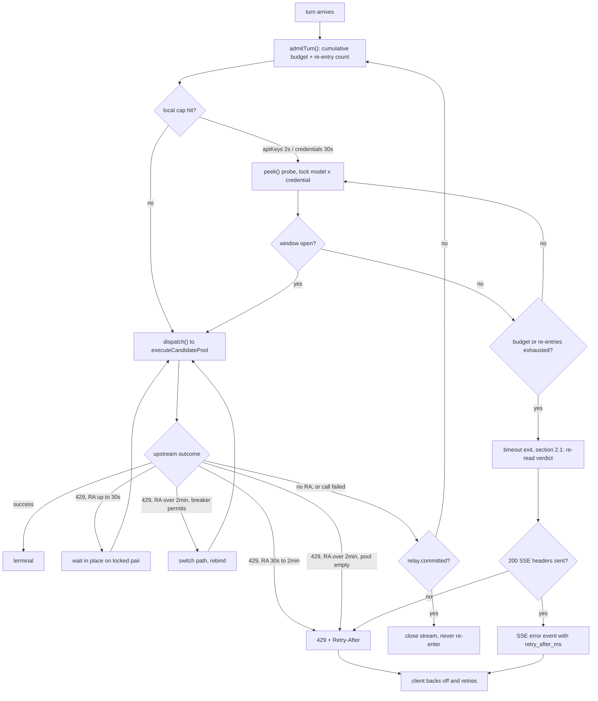

# ADR-0023: Rate-Limit Waiting and the Re-entrant Admission Loop

Date: 2026-11-14
Status: **Proposed** (design ratified before implementation; see Status note)
Governs: `backend/src/server.ts` (inbound auth gate and grace),
`backend/src/ratelimit/rate-limiter.ts` (`peek` / `evaluate` / `penalize`),
`backend/src/pipeline/orchestrator.ts` (`executeCandidatePool`, the outbound cap
gate, KEEP-BOUND, upstream-429 feedback), `backend/src/resilience/error-classifier.ts`
(429 classification and `Retry-After` parsing), `backend/src/surfaces/chat-pipeline.ts`
(terminal-send discipline), `backend/src/config/{index,types,defaults}.ts` (knobs),
`backend/src/config/comments-{en,zh}.ts` (console comment dictionaries).

> **Status note.** The corpus convention (`docs/adr/README.md`) is that every
> record describes SHIPPED behavior. This record deliberately breaks that rule:
> the decision was ratified ahead of the code so the implementation has one
> contract to follow. NOTHING below describes current runtime behavior. Its
> status MUST move to `Accepted` / `Implemented` in the same commit that lands
> the code (`AGENTS.md`: code and governing ADR move together), and the index
> row must be updated with it. Until then, treat every section as a target.

## Context

Three requirements conflict, and the current code satisfies them only
individually:

1. **A turn must not be interrupted.** For a coding agent, a 429 or a truncated
   stream discards an in-flight long task and its accumulated context. A wait of
   seconds is far cheaper than an interrupted turn. Fast-fail is a last resort,
   not a default.
2. **Switching paths is expensive.** Rebinding to another credential or model
   burns the upstream prompt cache. A local cap is a hint, not a failure
   (`cap != failure`), so it must never be the reason a bound session moves.
3. **Switching is only legal after the breaker says so.** Upstream truth, not a
   local shaping verdict, is what licenses a failover or a rebind.

The shipped behavior scatters the response across four places, each timing its
own wait independently:

- the inbound auth gate sleeps at most `inboundGraceMs` (default 1 s, hard cap
  2 s) and then answers 429;
- the outbound cap gate either skips to the next candidate or, for a keep-bound
  session or the last candidate, **forces the call through a full window** and
  lets the upstream produce the 429;
- a short upstream 429 (integer `Retry-After <= 2 s`) gets ONE in-place sleep,
  longer ones fail over and eventually throw a plain execution error with no
  `Retry-After` and no `RateLimit-*` headers;
- an upstream 429 without `Retry-After` writes a 60 s shaping cooldown via
  `penalize()`.

There is no per-turn waiting budget, so the three waits can stack; there is no
heartbeat, so a long wait becomes a client-side timeout, which is merely an
interruption under another name; and the outbound failure path is the worst of
the four because the client is not even told how long to back off.

## Decision

### 1. One re-entrant admission function, not scattered waits

A single internal `admitTurn()` owns admission, the waiting budgets and the
retry counter for the whole turn. Deep layers do not start their own open-ended
waits: they either wait in place under the contract in section 3, or **return to
the admission function**.

- At most **2 re-entries** (3 attempts total) per turn.
- The two triggers for a return are **internal retry requested** and **call
  failed**, both gated on `!relay.committed` (section 4).
- A re-entry is a continuation of the SAME turn, not a new HTTP request: no
  second authentication, no second `tryDispatch()` slot consumption (the
  "denials are not counted" contract is preserved), no duplicate usage
  accounting, no duplicate trace or capture terminal.
- Budgets are **cumulative per turn**, not reset per attempt. A 30 s budget is
  30 s across all three attempts combined; otherwise three attempts would
  silently become 90 s and there would be no global budget after all.

### 1.1 Control flow at a glance

> Diagram scope: this is the first flowchart in the ADR corpus, present because
> this record describes a TARGET control flow whose ownership and re-entry
> points cannot be carried by tables. Node labels are part of the contract — the
> zh-CN mirror must stay in step. Thresholds, `Retry-After` value classes and
> response carriers remain normative in the tables of sections 2.1 and 3;
> **where the diagram and a table disagree, the table wins** — the diagram
> answers "who owns the control flow", not "what the values are".
>
> The **full diagrams** (three views: the end-to-end path, the 429 ladder, and
> the timeout exit, with a section map and maintenance rules) are archived in
> [Rate-Limit Waiting — Complete Control Flow](../design/rate-limit-waiting-flow.md).
> This ADR keeps only the overview.

### 2. Two inbound waiting budgets

| Cap hit | Cumulative budget | Probe interval |
| :--- | :--- | :--- |
| `apiKeys[].limits` (client key) | 2 s | 1 s |
| `credentials:` overlay (outbound, local) | 30 s | 1 s |

Both values are configurable. A probe is a **non-consuming** `peek()` — waiting
never occupies a window slot; the slot is taken by `dispatch()` only when the
call actually proceeds. When `evaluate()` reports a known `msUntilBelow`, the
first probe may sleep straight to that instant (plus small jitter to
de-synchronize peers racing one freed slot) instead of polling; the 1 s interval
is then a ceiling for re-probing after a still-full verdict. Repeated probing is
deliberate: a peer may free a slot, or a new cooldown may be installed while we
wait.

Waiting keeps the **same `model x credential` pair locked**. No
`selectCredential()` re-run, no `selection.bind`, no rebind — this is the
KEEP-BOUND iron law applied to the wait itself, not just to the refusal.

Only when the cumulative budget or the re-entry count is exhausted does the gate
answer **429 + `Retry-After` + `RateLimit-*`** (value and carrier in section 2.1).
Fast-fail is the last branch of this function, not its entry point.

### 2.1 Budget exhaustion must still return `Retry-After`

Exhausting either budget in section 2 is the only legitimate moment for fast-fail,
but "fail" means **the gateway stops waiting on the client's behalf**, not that the
turn is discarded. A client SDK only backs off and retries on a well-formed
`429 + Retry-After`; a plain execution error with no backoff hint (today's
`executionError()` in `chat-pipeline.ts`) is read as non-retriable and the turn is
lost client-side anyway. Both timeouts therefore hand the backoff instant back.
Four rules are part of that contract, not notes on it:

**(1) Use the verdict at the instant of timeout, never the first probe.** Windows
keep aging during the wait and peers may take the freed slot. Answering with the
first `retryAfterMs` makes the client wait a full original window on top of the
30 s the gateway already spent. The grace branch in `server.ts` already
establishes this (post-grace verdict); `RateLimit-Reset` shares the source and is
also a **remaining** delta.

**(2) Time-window verdicts are exact; non-time-window verdicts must not pretend
to be.**

| Verdict source | Time-window? | Returned `Retry-After` |
| :--- | :--- | :--- |
| `requests` / `tokens` / `costUsd` sliding windows (`msUntilBelow()`, max over all full constraints) | yes | **Exact**: earliest point the subject as a whole is admissible − now |
| `penalize()` cooldown / breaker cooldown (`until − now`) | timer, equally exact | **Exact**: remaining cooldown |
| Window full purely on token reservations (`msUntilBelow === 0` → `RESERVATION_RETRY_FLOOR_MS`) | no | **Probe lower bound**: `max(probeIntervalMs, 1 s)`, flagged `estimate` in the event ledger; never echo `1` |
| Whole pool unavailable / pool-minimum time-to-available (section 3) | no | **Lower bound**, not a promise |

The third row matters: reservations do not age out (stated in `rate-limiter.ts`),
so 1 s is a guessed floor. Echoing it produces a "return in 1 s → still full →
another 1 s" retry storm instead of a convergent backoff. `costUsd` looks like a
quota but reopens on time as well: it **must** answer `429 + Retry-After` and never
`402`, because SDKs read 402 as "do not retry" (the inbound gate comment in
`server.ts` already fixes this contract).

**(3) The carrier forks on whether the 200 SSE headers have been written — this
is the real gap in the current implementation.**

| Timeout site | Carrier |
| :--- | :--- |
| `apiKeys[].limits`, still in the auth preHandler | A real `429` + `Retry-After` / `RateLimit-Limit` / `-Remaining` / `-Reset`, body `code: rate_limit_exceeded` |
| `credentials:` cap, inside the pipeline, no SSE headers yet | Orchestrator raises a structured `RateLimitWaitExhausted` carrying `retryAfterMs` / `rule` / `limitedBy` / `subject`; the surface turns it into the same 429. It must **not** degrade into a generic 5xx execution error |
| 200 SSE headers already written for heartbeats | 429 JSON is no longer legal (section 4); the backoff instant goes into the SSE error event payload (e.g. `error.retry_after_ms`) and the stream closes |

The third row is not optional: if the frames emitted during the wait carry no
backoff instant, a streaming client still receives an information-free
interruption and the heartbeat in section 4 buys nothing. The `RateLimit-*`
trio describes the client's own contract on the inbound path; on the outbound
path it describes a credential the caller does not own, so only `Retry-After`
(and optionally `RateLimit-Reset`) crosses the boundary — `RateLimit-Limit` /
`-Remaining` stay internal, surfaced in the event ledger instead.

**(4) An inbound timeout uses the locked pair's time, not the pool minimum.**
The pair stays locked while waiting (section 2, KEEP-BOUND), so a client retry
will most likely rebind to the same `model x credential`. Answering with section
3's `min(peek(...))` may advertise another credential's opening time; the client
returns then and hits another 30 s timeout on the still-closed pair. The pool
minimum is used only when switching is legal (`Retry-After >= 2 min` and the
breaker gate permits). Format is uniformly `max(1, ceil(ms / 1000))`
delta-seconds; the error body may carry `waited_ms` so the client knows the
gateway already waited and does not stack a full backoff on top.

### 3. Upstream 429: one ladder ordered by cache cost

| Condition | Action |
| :--- | :--- |
| `Retry-After <= 30 s` (configurable) | **Wait in place**, locked to the same pair, then dispatch locally. The cache survives. |
| `30 s < Retry-After < 2 min` (configurable) | **Return failure + `Retry-After`**. |
| `Retry-After >= 2 min`, pool has an available candidate | **Switch path** (rebind allowed), but only through the existing `canExecuteScoped` breaker gate. |
| `Retry-After >= 2 min`, no candidate available | **Return `Retry-After` = the pool's minimum time-to-available**, computed as `min(peek(subject).retryAfterMs)` over the pool including cooldowns, floored at 1 s. |
| No `Retry-After` | **Return to the admission function** — let probing, not a guessed constant, decide the wait. |

The thresholds are ordered by the cost of the action. Waiting is cheapest while
the cache is warm; returning a well-formed `Retry-After` is next; switching paths
is last because it destroys the cache. A switch therefore becomes legal only
when waiting has become uneconomic AND the breaker gate permits it — the local
cap never licenses a switch on its own. This is the resolution of the paradox:
"do not interrupt" and "do not switch before the breaker agrees" are both held,
and waiting is the only action available in the interval between them.

### 4. Hard constraints

These are not optional refinements; without them the decision is
self-contradictory.

- **An RA-less 429 must not write a shaping cooldown.** `evaluate()` consults
  `cooldowns` BEFORE window math (`rate-limiter.ts`), so a 60 s `penalize()` on
  the no-`Retry-After` branch makes every probe inside a 30 s budget report
  roughly 60 s-to-available. The re-entry would be mathematically guaranteed to
  time out. The breaker still records the failure independently; only the
  shaping cooldown is suppressed. If a floor is needed, it must share its source
  with `maxWaitMs`.
- **`committed` is terminal.** When bytes have reached the client, neither an
  in-place retry, a failover, nor a return to the admission function is legal:
  all would emit a second copy of a partly consumed turn. The stream closes
  without `[DONE]`, as today.
- **Heartbeats are required.** No SSE keep-alive exists in `server.ts` or
  `surfaces/`. During a wait, a `stream: true` turn must emit periodic SSE
  comment frames so the client SDK's read timeout does not fire first. Writing
  the 200 SSE headers changes the terminal discipline: once they are out, a
  final failure can only be an error event or a closed stream, never a 429 JSON
  body. Non-streaming wires have no heartbeat channel, so their cumulative
  budget must stay below the client SDK's common timeout.
- **A timeout must carry a backoff instant.** Section 2.1 is normative: a
  budget-exhausted denial without `Retry-After` (or its SSE error-event
  equivalent) breaks the "turn must not be interrupted" premise at the client.
  The `budget-exhausted` ledger event must record `retryAfterMs` and whether the
  value is exact or an `estimate`.
- **No double accounting.** See section 1. Every re-entry carries the original
  `requestId` (ADR-0021) and the original admission state.
- **`Retry-After` parsing is shared and lossless.** The four provider call sites
  currently use `parseInt(header, 10)`: `0.5` becomes `0` and is discarded, an
  HTTP-date becomes `NaN` and is discarded, so a genuinely short wait is
  misclassified as "no declaration" and skips the in-place branch. Replace them
  with one `Number` + `Number.isFinite` + milliseconds helper (the shape already
  used by `harness/net.ts`); an unparseable HTTP-date degrades explicitly to
  "no `Retry-After`", which routes to the re-entry branch above.

### 5. Configuration surface

All values are operator-configurable and must appear in the console comment
dictionaries (ADR-0016); backend defaults live in `config/defaults.ts` with a
frontend mirror in `frontend/src/lib/defaults.ts`.

| Key | Default | Note |
| :--- | :--- | :--- |
| `rateLimit.inboundGraceMs` | 2000 | Reinterpreted as a **cumulative per-turn** budget; the hard `MAX_INBOUND_GRACE_MS = 2000` clamp must be relaxed or the key cannot be raised. |
| `rateLimit.probeIntervalMs` | 1000 | Capability probe interval for both inbound budgets. |
| `rateLimit.outboundCredentialWaitMs` | 30000 | Cumulative budget for a local credential cap. |
| `retry.inplace.maxRateLimitWaitMs` | 30000 | **Reuse, do not invent**: this is already the "longest 429 we wait out in place" knob (today 2000). |
| `retry.inplace.failoverThresholdMs` | 120000 | New: the boundary above which a path switch becomes legal. |
| `retry.admission.maxReentries` | 2 | New, distinct from `inplace.maxAttempts` and `failover.maxAttempts`. |

`MAX_GRACE_SLEEPERS` becomes a bounded waiting **queue** rather than a
shed-on-overflow switch: exceeding it delays, it does not answer 429. Only a
queue timeout is a denial.

### 6. Why fast-fail survives in exactly one band

`30 s < Retry-After < 2 min` is the sole interval that still *chooses* fast-fail;
budget exhaustion (section 2.1) is a forced fallback, not a choice.
The upstream has explicitly asked for a wait longer than a client's patience and
shorter than a cache-preserving reason to switch: holding the socket that long
produces a client-side timeout (a worse, silent interruption), while switching
burns the cache and the pool peers are likely under the same cap. A standard
`429 + Retry-After` hands the backoff to a client that already knows how to do
it. Everywhere else in the ladder the turn is preserved.

## Consequences

- Client-visible interruptions drop sharply: caps shorter than 30 s become
  latency, not errors. The cost is held sockets, which is why heartbeats and a
  bounded queue are part of the decision rather than follow-up work.
- A local cap changes from "a hint that forces one speculative call" into "an
  admission condition that can be waited out". It still never trips the breaker:
  the legality of a path switch continues to come only from a real upstream
  failure (ADR-0004 keeps rate limiting a separate axis).
- Observability becomes mandatory: every wait, re-entry, forced-through and
  exhaustion lands in the rate-limit event ledger with the pair identity, or
  the added latency is unexplainable. The `grace-admitted` / `denied` vocabulary
  needs `waited` / `reentered` / `budget-exhausted` companions.
- `executeCandidatePool` stays the single funnel (ADR-0005); the admission
  function wraps it, it does not fork it. The one-terminal-send discipline
  (ADR-0008) is unchanged except for the explicit SSE-header trade in section 4.

## Rejected alternatives

- **Three independent waits.** No global budget, unpredictable worst-case
  latency, and no single place to explain the delay.
- **Always switch paths.** Cheap per call, but destroys the prompt cache and
  violates the keep-bound iron law on a mere shaping hint.
- **Always fast-fail.** Optimizes gateway sockets at the expense of the actual
  product cost, which is an interrupted turn.
- **Unbounded queuing.** A hidden queue with no deadline; the cumulative
  budgets, the re-entry cap and the bounded queue are the answer.

## Implementation checklist

- [ ] Extract `admitTurn()`; carry `requestId`, admission state and cumulative
      elapsed wait across re-entries.
- [ ] Cumulative 2 s / 30 s budgets with 1 s capability probes; keep the pair
      locked.
- [ ] Replace the KEEP-BOUND `forced` immediate dispatch with a bounded wait on
      the same pair.
- [ ] Implement the 429 ladder and the pool-minimum `Retry-After`.
- [ ] Budget-exhaustion response contract (section 2.1): re-evaluate at timeout,
      structured `RateLimitWaitExhausted` → 429 headers, SSE error-event
      `retry_after_ms`, reservation-only lower bound with an `estimate` flag.
- [ ] Suppress the shaping cooldown on RA-less 429s; share the `Retry-After`
      parser.
- [ ] SSE comment heartbeat; bounded waiting queue.
- [ ] Config keys, `config/defaults.ts` + frontend mirror, console comment
      dictionaries, tests for `Retry-After: 0.5`, committed-stream, cumulative
      budget and the 60 s cooldown regression; add tests that a 30 s wait returns
      the REMAINING rather than the original `Retry-After`, that `costUsd`
      answers 429 not 402, and that a reservation-only window never answers 1 s.
- [ ] Move this record to `Accepted` / `Implemented` **in the same commit**.
