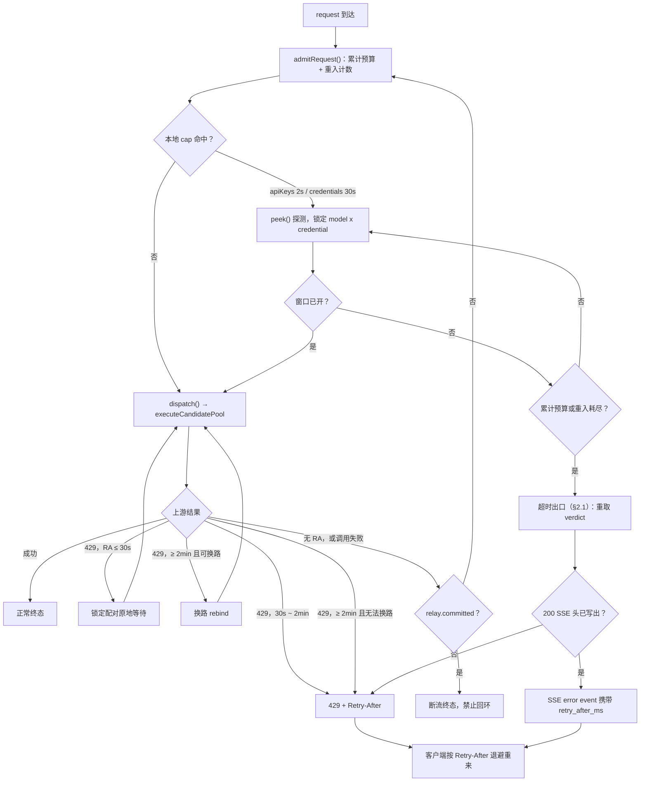

# ADR-0023：限流等待与可重入准入回路

日期：2026-11-14
状态：**拟议中**（决策先于实现敲定，见「状态说明」）
约束范围：`backend/src/server.ts`（入站鉴权门与宽限等待）、
`backend/src/ratelimit/rate-limiter.ts`（`peek` / `evaluate` / `penalize`）、
`backend/src/pipeline/orchestrator.ts`（`executeCandidatePool`、出站 cap 门、
KEEP-BOUND、上游 429 反馈）、`backend/src/resilience/error-classifier.ts`
（429 分类与 `Retry-After` 解析）、`backend/src/surfaces/chat-pipeline.ts`
（单次终态发送纪律）、`backend/src/config/{index,types,defaults}.ts`（配置项）、
`backend/src/config/comments-{en,zh}.ts`（控制台注释词典）。

> **状态说明。** 本语料库的惯例（`docs/adr/README.md`）是每篇记录只描述**已落地**
> 的行为。本篇有意打破该惯例：决策先于代码敲定，好让实现有唯一契约可循。
> **只有「背景」一节是当前运行时行为的基线**；第 1–6 节（决策、配置面、后果、
> 实现清单）描述的是**目标状态**。代码落地的同一个 commit 里
> （`AGENTS.md`：代码与管辖 ADR 同步）：本篇状态行改为 `已接受`，两份 ADR 索引
> 的 0023 行状态列改为 `已实现`，两份流程图配套文档
> （`docs/design/rate-limit-waiting-flow.md` 及其 `zh-CN/` 镜像）同步改为
> `已实现`，并刷新索引摘要。在此之前，请把决策与配置面各节当作目标状态。

## 背景

三项要求彼此冲突，现行代码只分别满足了其中一部分：

1. **用户的一轮任务不能被中断。** 对 coding agent 来说，一次 429 或被掐断的流会
   报废正在跑的长任务及其已积累的上下文。几秒的等待远比中断一次用户 turn 便宜。
   快速失败是最后手段，不是默认路径。（**目标**是 turn 级；以下全部**机制**——
   预算、重入、`committed`、心跳——都是 request 级，见 ADR-0024。）
2. **换路很贵。** 重绑到另一个凭证或模型会烧掉上游 prompt cache。本地 cap
   只是提示，不是失败（`cap != failure`），因此绝不能成为已绑定会话移动的理由。
3. **只有断路器点头之后，换路才合法。** 允许故障转移或重绑的是上游事实，
   不是本地整形判定。

现行实现把应对策略散在四处，各自独立计时：

- 入站鉴权门最多等 `rateLimit.inboundGraceMs`（下文简称 `inboundGraceMs`，
  默认 1 s，硬上限 2 s），然后回 429；
- 出站 cap 门要么跳到下一个候选，要么在 keep-bound 会话 / 最后一个候选时
  **在窗口已满的情况下强制放行**，让上游去产出那个 429；
- 上游短 429（整数 `Retry-After <= 2 s`）原地等一次；更长的则故障转移，
  最终抛出一个不带 `Retry-After`、也没有 `RateLimit-*` 头的普通执行错误；
- 无 `Retry-After` 的上游 429 会通过 `penalize()` 写下 60 s 整形冷却。

没有「每个 request 的等待预算」，三处等待可以叠加；没有心跳，长等会先撞上客户端
超时——那只是换了个名字的中断；而出站失败路径是四者中最糟的，因为客户端
连该退避多久都不知道。

## 决策

### 1. 一个可重入的准入函数，而不是散落各处的等待

由唯一的内部函数 `admitRequest()` 统管**一个入站 request**（`requestId`）的准入、
等待预算与重试计数。单位是 request，绝不是用户提示。
深层不再自行开启无边界等待：要么按第 2、3 节契约原地等，要么**返回准入函数**。

- 每个 request 最多**重入 2 次**（合计 3 次尝试）。
- 触发返回的两个条件是「内部要求重试」与「调用失败」，且两者都必须附加
  `!relay.committed` 前提（见第 4 节）。
- 重入是**同一个入站 request 的延续**：不二次鉴权、不二次
  `tryDispatch()` 占槽（「拒绝不计数」契约保持）、不重复计量 usage、不重复写
  trace / capture 终态。
- 预算按**每个 request 累计**，不随每次尝试重置。30 s 就是三次尝试合计 30 s；
  否则三次尝试会悄悄变成 90 s，又退回「没有全局预算」。

### 1.1 控制流总览

> 图的边界：这是本语料库的第一张流程图，原因是本篇描述**目标态控制流**，
> 其归属关系与回环点是表格无法承载的。节点标签属于契约的一部分，`zh-CN`
> 镜像必须同步。阈值、取值类别与响应载体仍以第 2.1 节和第 3 节的表格为准；
> **图表与表格冲突时，以表格为准**——图只回答「控制流归谁」，不回答具体数值。
>
> **完整流程图**（三张视图：全链路、429 阶梯、超时出口，附 ADR 章节对照与维护约定）
> 单独留档于 [限流等待——完整控制流图（中文）](../../design/zh-CN/rate-limit-waiting-flow.md)
> （[英文正本](../../design/rate-limit-waiting-flow.md)）；本 ADR 只保留这张总览。
> 中文镜像与英文正本节点 ID、边拓扑逐字一致，只翻译标签与说明文字。本 ADR
> 只保留总览，其中省略了 Fig. 1 的心跳回路与 verdict 来源分支。

### 2. 两档入站等待预算

| 命中的 cap | 累计预算 | 探测间隔 |
| :--- | :--- | :--- |
| `apiKeys[].limits`（客户端密钥） | 2 s | 1 s |
| `credentials:` overlay（出站、本地） | 30 s | 1 s |

两者均可配置。探测是**非消耗性**的 `peek()`——等待本身不占窗口槽，只有调用
真正发出时才由 `dispatch()` 占槽。当 `evaluate()` 给出已知的 `msUntilBelow`，
首个探测可以直接睡到该时刻（加少量抖动，避免多个等待者抢同一个释放槽时
同步惊群），此后 1 s 是「复查仍满」时的重探上限。保留重复探测是刻意的：
等待期间可能有同伴释放槽位，也可能新装上一个冷却。

等待期间**锁定同一个 `model x credential` 配对**：不重跑 `selectCredential()`、
不设 `selection.bind`、不 rebind。这是把 KEEP-BOUND 铁律从「拒绝时」延伸到
「等待时」。

只有当累计预算或重入次数耗尽，门才回答
**429 + `Retry-After` + `RateLimit-*`**（数值与载体见第 2.1 节）。快速失败是这个
函数的最后一个分支，不是它的入口。

### 2.1 预算耗尽时仍必须返回 `Retry-After`

在入站准入路径上，两档预算耗尽是快速失败的唯一合法时机，但「失败」指的是
**网关不再代等**，不是
「这个 request 报废」。客户端 SDK 只有拿到规范的 `429 + Retry-After` 才会自动退避
重来；一个不带退避时刻的普通执行错误（当前 `chat-pipeline.ts` 的
`executionError()`）会被判为不可重试，request 在客户端侧照样丢失。因此两档超时都
必须把退避时刻交出去，以下四条是契约的一部分，不是建议：

**(1) 取超时瞬间的 verdict，不取首次探测的。** 等待期间窗口继续老化，同伴也可能
占掉刚释放的槽位。以首次 `retryAfterMs` 作答，会让客户端在网关已等 30 s 之后
再等一个完整的原始窗口。`server.ts` 的宽限分支已确立该原则（post-grace
verdict），重入回路必须沿用；`RateLimit-Reset` 与 `Retry-After` 同源，都是
**剩余**秒数。

**(2) 时间窗口类给精确值，非时间窗口类不得假装精确。** `evaluate()` 的
`retryAfterMs` 有两种来源，语义不同：

| verdict 来源 | 时间窗口？ | 返回的 `Retry-After` |
| :--- | :--- | :--- |
| `requests` / `tokens` / `costUsd` 滑动窗口（`msUntilBelow()`，取所有满约束的 max） | 是 | **精确值**：该 subject 整体最早可放行时刻 − now |
| `penalize()` 冷却 / 断路器冷却（`until − now`） | 定时器，等价确定 | **精确值**：剩余冷却 |
| 窗口仅由 token reservation 撑满（`msUntilBelow === 0` → `RESERVATION_RETRY_FLOOR_MS`） | 否 | **探测下界**：取 `max(probeIntervalMs, 1 s)`，事件账本标 `estimate`；不得原样回 `1` |
| 全池不可用 / 池内最小可用时间（第 3 节） | 否 | **下界**，不是承诺 |

第三行是关键：reservation 不随时间老化（`rate-limiter.ts` 注释明示），1 s 是
拍出来的 floor，原样返回会诱发「1 s 后回来 → 仍满 → 再 1 s」的重试风暴，把
本该收敛的退避变成持续冲击。`costUsd` 看着像配额，但同样按时间窗口重开，
**必须回 429 + `Retry-After`，绝不能回 402**——402 会让客户端 SDK 判定不重试
（`server.ts` 入站注释已确立该契约）。

**(3) 载体按「是否已写出 200 SSE 头」分叉，这是当前实现真正的缺口。**

| 超时位置 | 载体 |
| :--- | :--- |
| `apiKeys[].limits`，仍在 auth preHandler | 真正的 `429` + `Retry-After` / `RateLimit-Limit` / `-Remaining` / `-Reset`；错误体 `code: rate_limit_exceeded` |
| `credentials:` cap，pipeline 内部且未写 SSE 头 | orchestrator 抛结构化 `RateLimitWaitExhausted`（携带 `retryAfterMs` / `rule` / `limitedBy` / `subject`），由 surface 转成同一个 429。**不得**退化成泛化 5xx 执行错误 |
| 已因心跳写出 200 SSE 头 | 头已发出就不能再回 429 JSON（第 4 节）；退避时刻只能进 SSE error event 的 payload（如 `error.retry_after_ms`）并关闭流 |

第三条不是可选项：若心跳期间写出的帧里没有退避时刻，流式客户端拿到的仍是
一次无信息的中断，第 4 节的心跳就白做了。另外 `RateLimit-*` 三头在入站描述
的是客户端自己的契约；出站描述的是调用方并不拥有的凭证配置，因此出站只让
`Retry-After`（可选 `RateLimit-Reset`）越过边界，`RateLimit-Limit` /
`-Remaining` 留在内部事件账本，不对外暴露。

**(4) 入站超时用「被锁定配对」的时间，不用池内最小值。** 等待期间配对锁定
（第 2 节 KEEP-BOUND），客户端重试大概率仍绑回同一 `model x credential`。
按第 3 节的 `min(peek(...))` 作答，该值可能来自另一个凭证，客户端回来时绑定
那个仍未开窗，于是再撞一次 30 s 超时。池内最小值**只属于第 3 节的上游 429
分支**，且恰好在**无法换路**（池内无候选，或断路器门不放行）时返回；入站
预算超时一律不用它。格式统一为
`max(1, ceil(ms / 1000))` 的 delta-seconds；错误体可选带 `waited_ms`，让客户端
知道网关已代等过，不必再叠加自己的完整退避。

### 3. 上游 429：按 cache 成本排序的一条阶梯

| 条件 | 动作 |
| :--- | :--- |
| `Retry-After <= 30 s`（可配置） | **原地等待**，锁定同一配对，等完就地派发。cache 保住。 |
| `30 s < Retry-After < 2 min`（可配置） | **返回失败 + `Retry-After`**。 |
| `Retry-After >= 2 min`，`canExecuteScoped` 放行**且**池内有可用候选 | **换路**（允许 rebind）。 |
| `Retry-After >= 2 min`，**无法换路**（池内无候选**或**断路器不放行） | **返回 `Retry-After` = 池内最小可用时间**，即全池 `min(peek(subject).retryAfterMs)`（含冷却），下限 1 s。 |
| 无 `Retry-After` | **返回准入函数重试**——由探测而非拍脑袋的常量决定等多久。 |

阈值按动作成本排序：cache 还热时等待最便宜；其次是给出规范的
`Retry-After`；换路排最后，因为它销毁 cache。因此只有当等待已不经济、
**并且**断路器门放行时，换路才合法——本地 cap 永远不单独授权换路。这正是
那个悖论的解：「不中断」与「断路器点头前不换路」同时成立，而两者之间的
空档里，唯一可用的动作就是等。

### 4. 硬约束

以下不是可选的优化项；缺了任何一条，本决策自相矛盾。

- **无 RA 的 429 不得写整形冷却。** `evaluate()` 在窗口数学**之前**查
  `cooldowns`（`rate-limiter.ts`），因此无 `Retry-After` 分支上一次 60 s
  `penalize()` 会让 30 s 预算内的每一次探测都读到约 60 s 的可用时间，
  重入在数学上必然超时。断路器仍独立记录该失败，只抑制整形冷却；若确需
  下限，必须与 `retry.inplace.maxRateLimitWaitMs`（同一份等待预算）同源，
  不得再立一个独立常量。
- **`committed` 即终态。** 一旦字节已到客户端，原地重试、故障转移、返回
  准入函数都不合法：都会让客户端收到一份已消费过一半的重复输出。流按现行
  做法不带 `[DONE]` 关闭。
- **必须有心跳。** `server.ts` 与 `surfaces/` 目前没有任何周期性的 SSE
  keep-alive / `: ping` 帧（唯一的注释帧是结尾的 `: ocr-summary`，那是完成
  摘要，不是心跳）。等待期间，`stream: true` 的 request 必须周期性发送 SSE
  注释帧，否则客户端
  SDK 的读超时会先触发。写出 200 SSE 头会改变终态纪律：头一经发出，最终
  失败只能是 error event 或断流，绝不能再回 429 JSON。非流式线路没有心跳
  通道，其累计预算必须压在客户端 SDK 常见超时之内。
- **预算耗尽必须带退避时刻。** 第 2.1 节是规范而非附注：不带 `Retry-After`
  （或其 SSE error event 等价字段）的超时拒绝，会让「用户的一轮任务不被中断」的前提在
  客户端侧失效。`budget-exhausted` 事件必须记录 `retryAfterMs`，以及该值是
  精确值还是 `estimate`。
- **不重复计量。** 见第 1 节。每次重入携带原始 `requestId`（ADR-0021）与
  原始准入状态。
- **`Retry-After` 解析要共享且无损。** 四个 provider 调用点**以及分类器自己的
  解析**（`error-classifier.ts`，还额外要求 `parsed > 0`）现在都用
  `parseInt(header, 10)`：`0.5` 变 `0` 被丢弃，HTTP-date 变 `NaN` 被丢弃，
  本该短等的 429 于是被误判为「无声明」而跳过原地等待分支。**全部**改为统一的
  `Number` + `Number.isFinite` + 毫秒化辅助函数（`harness/net.ts` 已有该形状）；
  只修 provider 四处，分类器仍会丢弃同样的短等待。无法解析的 HTTP-date 显式
  降级为「无 `Retry-After`」，走上面的重入分支。此处 `RATE_LIMIT_BURST` 是
  `networkCause` / 可重试原因，不是分类器的 `ErrorCategory`（后者仍是
  `RATE_LIMITED`）。

### 5. 配置面

所有值都可由操作者配置，并必须进入控制台注释词典（ADR-0016）。**下表所有默认值
都是目标值**，不是当前运行时值。今天两个既有默认值是分散的：
`DEFAULT_INBOUND_GRACE_MS` 在 `config/index.ts`，
`DEFAULT_MAX_RATE_LIMIT_WAIT_MS` 在 `resilience/circuit-breaker.ts`，前端只镜像
了后者（`frontend/src/lib/defaults.ts`）。按 `AGENTS.md` 要求把运行时默认值
收敛到 `config/defaults.ts` 并补前端镜像，是本决策的一部分，不是对现状的描述。

| 键 | 目标默认 | 说明 |
| :--- | :--- | :--- |
| `rateLimit.inboundGraceMs` | 2000 | 语义改为**每请求累计**预算。今天默认是 **1000**（`config/index.ts`）；**2000 是 `MAX_INBOUND_GRACE_MS` 硬钳制**，必须放宽它，否则该键根本调不高。 |
| `rateLimit.probeIntervalMs` | 1000 | **新增键**：两档入站预算的能力探测间隔。 |
| `rateLimit.outboundCredentialWaitMs` | 30000 | **新增键**：本地凭证 cap 的累计预算。 |
| `retry.inplace.maxRateLimitWaitMs` | 30000 | **复用，不新造**：该键已完整存在（`resilience/types.ts` → 磁盘 schema → 注释词典 → 前端），就是「429 最长原地等待」旋钮；今天默认 **2000**。 |
| `retry.inplace.failoverThresholdMs` | 120000 | **新增键**：超过它换路才合法。 |
| `retry.admission.maxReentries` | 2 | **新增键**，与 `inplace.maxAttempts`、`failover.maxAttempts` 语义分离。 |

`MAX_GRACE_SLEEPERS` 改为有界**等待队列**，不再是超限即丢弃的开关：超限时
是延迟，不是回 429；只有排队超时才构成拒绝。

### 6. 为什么唯独这一档仍保留快速失败

`30 s < Retry-After < 2 min` 是唯一**主动选择**快速失败的区间；预算耗尽
（第 2.1 节）是被动兜底，不是选择。上游明确要求等一个
「长于客户端耐心、又短到不足以成为换路理由」的时间：硬持 socket 会撞上
客户端超时（更糟的静默中断），换路要烧 cache 且池中同伴大概率同在该 cap
之下。一个规范的 `429 + Retry-After` 把退避交给本来就懂退避的客户端。
阶梯其余各处，request 都被保住。

## 后果

- 客户端可感知的中断显著下降：短于 30 s 的 cap 变成延迟而非错误。代价是
  被持住的连接，所以心跳与有界队列是本决策的组成部分，不是后续优化。
- 本地 cap 从「逼出一次试探性调用的提示」变成「可以等过去的准入条件」。
  它仍然永不触发断路器：换路合法性的唯一来源依旧是真实的上游失败
  （ADR-0004 继续把限流当作独立一轴）。
- 可观测性变成必需：每次等待、重入、强制放行、预算耗尽都要带配对身份落进
  限流事件账本，否则新增的延迟无法解释。`grace-admitted` / `denied` 词表
  需要补 `waited` / `reentered` / `budget-exhausted`。
- `executeCandidatePool` 仍是唯一咽喉（ADR-0005）；准入函数包住它，而不是
  分叉它。单次终态发送纪律（ADR-0008）不变，唯一例外是第 4 节明示的
  SSE 头取舍。

## 已否决的备选

- **三处各自等待。** 没有全局预算、最坏延迟不可预测、延迟没有一个能解释的
  统一落点。
- **一律换路。** 单次调用便宜，但销毁 prompt cache，且会因一个纯整形提示
  违反 keep-bound 铁律。
- **一律快速失败。** 优化的是网关 socket，付出的是真正的产品代价——被中断
  的用户 turn。
- **无限排队。** 没有截止时间的隐藏队列；累计预算、重入上限与有界队列就是
  答案。

## 实现清单

- [ ] 抽出 `admitRequest()`；跨重入携带 `requestId`、准入状态与累计已等待时长。
- [ ] 2 s / 30 s 累计预算 + 1 s 能力探测；保持配对锁定。
- [ ] 把 KEEP-BOUND 的 `forced` 立即派发改成同一配对上的有界等待。
- [ ] 实现 429 阶梯与池内最小 `Retry-After`。
- [ ] 预算耗尽的响应契约（第 2.1 节）：超时瞬间重取 verdict、结构化
      `RateLimitWaitExhausted` → 429 三头、SSE error event 的 `retry_after_ms`、
      reservation-only 的下界与 `estimate` 标记。
- [ ] 抑制无 RA 429 的整形冷却；统一 `Retry-After` 解析器。
- [ ] SSE 注释心跳；有界等待队列。
- [ ] 配置键、`config/defaults.ts` + 前端镜像、控制台注释词典，以及
      `Retry-After: 0.5`、已提交流、累计预算、60 s 冷却回归的测试；补测
      「等待 30 s 后返回剩余而非原始 `Retry-After`」、`costUsd` 回 429 而非 402、
      reservation-only 不得回 1 s。
- [ ] **在同一个 commit 里**：本篇状态行改为 `已接受`，两份 ADR 索引的 0023 行
      状态列改为 `已实现`，两份流程图配套文档同步改为 `已实现`，并刷新索引摘要。
