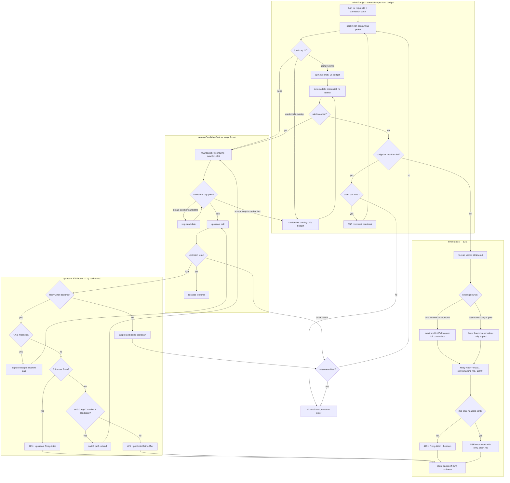
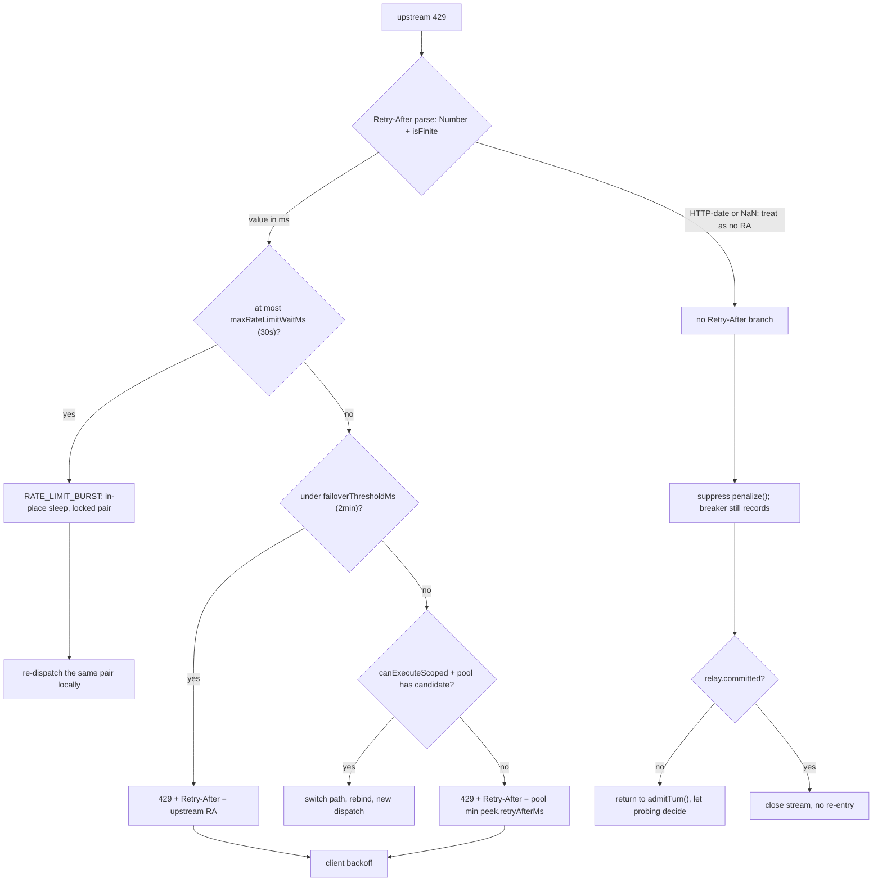
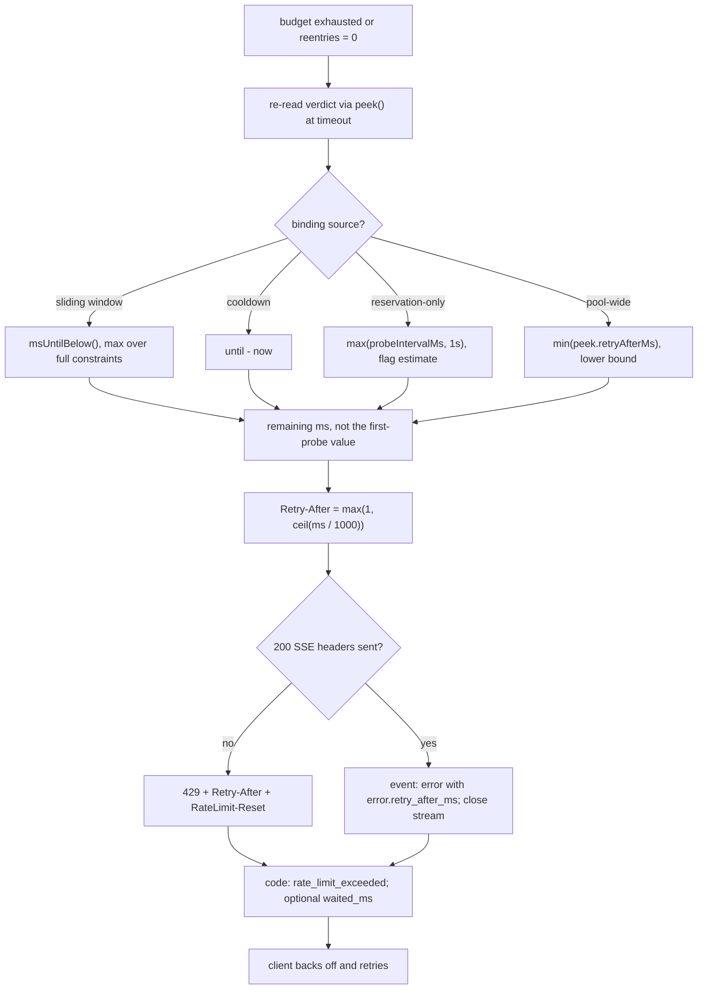

# Rate-Limit Waiting — Complete Control Flow

Companion diagrams for [ADR-0023](../adr/0023-rate-limit-waiting-and-reentrant-admission.md)
(§1 re-entrant admission, §2 budgets, §2.1 timeout exit, §3 the 429 ladder, §4 hard
constraints). The ADR keeps a condensed overview in §1.1; **this file is the
archival home of the full diagrams**.

> Status: **Proposed**, mirroring ADR-0023. The FLOWCHARTS describe the target
> state; the prose notes quoting `parseInt`, `evaluate()` or `penalize()`
> describe today's baseline, as ADR-0023's Context does. A zh-CN mirror lives at
> [`zh-CN/rate-limit-waiting-flow.md`](./zh-CN/rate-limit-waiting-flow.md):
> node IDs and edge topology are identical; only labels and prose are localized.
> This file is authoritative for structure. Where a diagram and an ADR table
> disagree, **the ADR table is normative**.

## 1. Full path

One turn, from admission to its single terminal. Subgraphs are the four owners of
control flow; every arrow crossing a subgraph boundary is either a re-entry into
`admitTurn()` or a handoff to the client.

Two arrows carry the whole decision: `P2 --> A4` is the replacement for today's
`forced` dispatch (an at-cap keep-bound pair **waits** instead of hitting a full
window), and `C0 --> A1` is the only re-entry out of a failed call. Both are
gated on `!relay.committed`; `C0 --> C1` is the terminal that forbids a second
copy of a partly consumed stream.

## 2. Upstream 429 ladder — zoom

`parseInt` at the four provider call sites AND in the classifier itself
(`error-classifier.ts`, which also requires `parsed > 0`) turns
`Retry-After: 0.5` into `0` and an HTTP-date into `NaN`; both are discarded today
and misrouted to the "no declaration" branch. Replacing only the provider sites
would leave `S1` dishonest. `RATE_LIMIT_BURST` here is the `networkCause` /
retriable cause, not the classifier's `ErrorCategory` (`RATE_LIMITED`).
A no-RA 429 must not write a shaping cooldown: `evaluate()` consults
`cooldowns` before window math, so a 60s `penalize()` would make every probe
inside a 30s budget report roughly 60s-to-available and the re-entry would be
mathematically guaranteed to time out.

## 3. Timeout exit and backoff handoff — zoom

`RateLimit-Limit` / `-Remaining` cross the boundary **only** on the inbound
path, where they describe the client's own key contract; on the outbound path
they describe a credential the caller does not own and stay in the event ledger.
A `costUsd` window reopens by time, so it answers `429 + Retry-After`, never
`402` — SDKs read 402 as "do not retry". A window full purely on token
reservations does not age out, so the 1s `RESERVATION_RETRY_FLOOR_MS` is a
guessed floor: echoing it produces a "return in 1s, still full, another 1s"
retry storm.

## 4. Diagram-to-ADR map

Config keys inside node labels drop their module prefix; fully qualified names
and target defaults are in ADR-0023 §5.

| Nodes | ADR-0023 section | Governing statement |
| :--- | :--- | :--- |
| `A0`–`A9` | §1, §2 | one `admitTurn()`, cumulative budget, pair locked while waiting |
| `P1`–`P6` | §1, consequences | `executeCandidatePool` stays the single funnel; denials are not counted |
| `R0`–`R8` | §3 | the ladder ordered by cache cost; local caps never license a switch |
| `E0`–`E8` | §2.1 | budget exhaustion still returns a usable backoff instant |
| `C0`, `C1` | §4 | `committed` is terminal |
| `S1`, `S9`, `S11` | §4 | shared lossless parser; no shaping cooldown on RA-less 429s |
| `T2`–`T8` | §2.1 | exact value vs lower bound; remaining, not original |

## 5. Maintenance

- Fig. 1 is the only end-to-end picture. Figs. 2 and 3 zoom into its `R` and `E`
  subgraphs; a change to a branch must be made in both places.
- ADR-0023 §1.1 is the condensed view of Fig. 1. If Fig. 1's topology changes,
  check whether §1.1 still tells the same story — this is the FIRST deliberate
  pair (Fig. 1 ↔ §1.1), not two independent copies.
- The zh-CN mirror is
  [`zh-CN/rate-limit-waiting-flow.md`](./zh-CN/rate-limit-waiting-flow.md) —
  the SECOND deliberate pair (this file ↔ the mirror). Node IDs and edge
  topology are identical; only labels and prose are localized. This file is
  authoritative for structure: a topology change must land in both files in the
  same commit and pass a structural diff.
- The mirror lives in a `zh-CN/` subdirectory so it stays outside the
  English-doc CJK scan (`docs/design/*.md` matches one level only).
- When the code lands, ONE commit promotes the whole set: the Status line of
  both ADR-0023 language versions → `Accepted`, both index Status cells →
  `Implemented`, and both diagram companions → `Implemented`.
