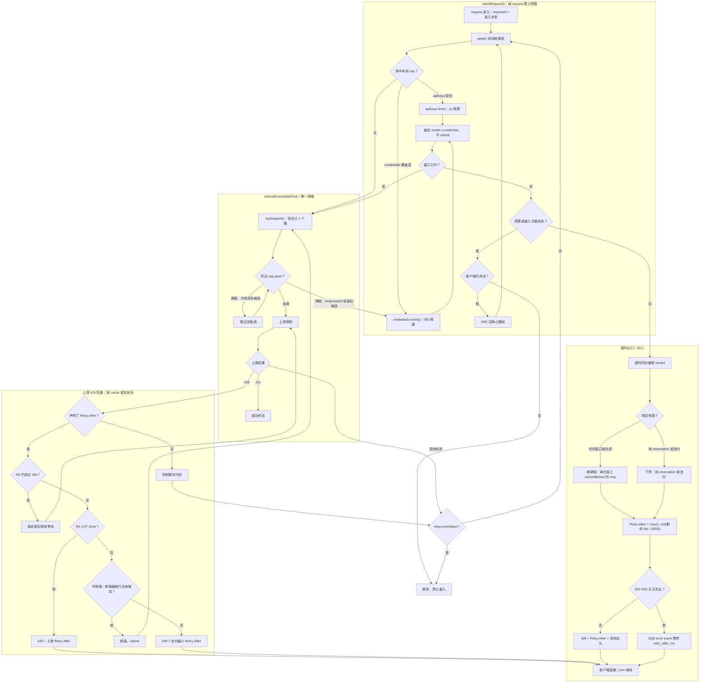
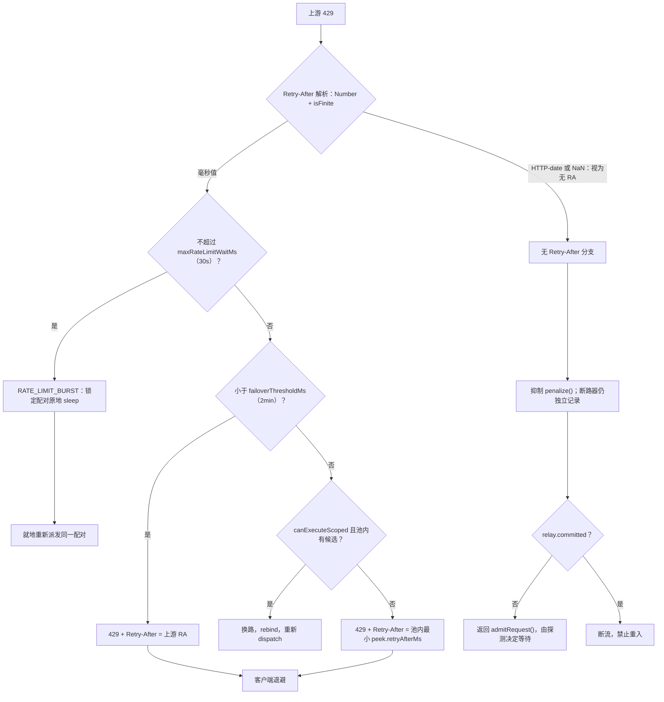
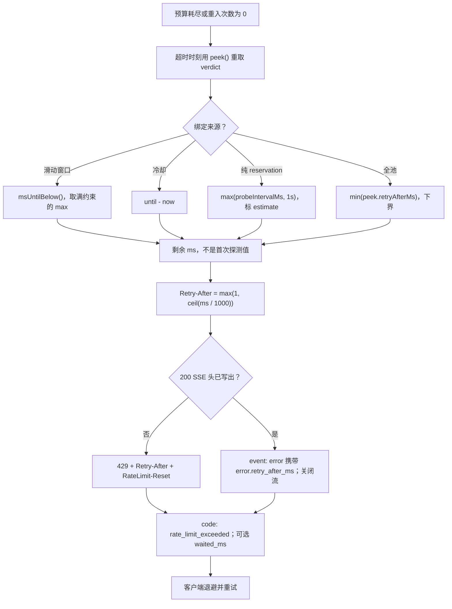

# 限流等待——完整控制流图

[ADR-0023](../../adr/zh-CN/0023-rate-limit-waiting-and-reentrant-admission.md)
的配套流程图（第 1 节可重入准入、第 2 节等待预算、第 2.1 节超时出口、
第 3 节 429 阶梯、第 4 节硬约束）。ADR 的 §1.1 只保留一张收敛总览；
**本文件是完整流程图的留档位置**。英文正本：
[`rate-limit-waiting-flow.md`](../rate-limit-waiting-flow.md)。

> 状态：**拟议中**，与 ADR-0023 同步。**流程图描述目标状态**；引用
> `parseInt` / `evaluate()` / `penalize()` 的说明段落描述的是今天的基线，
> 与 ADR-0023「背景」一节一致。本文件是英文正本的中文镜像：
> **节点 ID 与边拓扑逐字一致，只翻译标签与说明
> 文字**；结构以英文正本为权威。图表与 ADR 表格冲突时，**以 ADR 表格为准**。

## 1. 全链路

一个 request 从准入到唯一终态。四个 subgraph 是控制流的四个归属方；每条跨越
subgraph 边界的箭头，要么是重入 `admitRequest()`，要么是向客户端交接。

两条箭头承载了整个决策：`P2 --> A4` 用来取代今天的 `forced` 立即派发
（满额的 keep-bound 配对**改为等待**，而不是硬打一个满窗口），
`C0 --> A1` 则是调用失败后唯一合法的重入。两者都以 `!relay.committed` 为前提；
`C0 --> C1` 是那个禁止向客户端输出第二份半截流的终态。

## 2. 上游 429 阶梯（放大）

四个 provider 调用点**以及分类器自己的解析**（`error-classifier.ts`，还额外
要求 `parsed > 0`）上的 `parseInt` 会把 `Retry-After: 0.5` 变成 `0`、把
HTTP-date 变成 `NaN`；两者今天都被丢弃，误送进「无声明」分支。只修 provider
四处，`S1` 仍然不诚实。此处 `RATE_LIMIT_BURST` 是 `networkCause` / 可重试原因，
不是分类器的 `ErrorCategory`（后者仍是 `RATE_LIMITED`）。无 RA 的 429 必须
不写整形冷却：`evaluate()` 在窗口数学**之前**查 `cooldowns`，因此一次 60s
的 `penalize()` 会让 30s 预算内每次探测都读到约 60s 的可用时间，重入在
数学上必然超时。

## 3. 超时出口与退避交接（放大）

`RateLimit-Limit` / `-Remaining` **只在入站路径**越过边界，那里描述的是
客户端自己的密钥契约；出站路径描述的是调用方并不拥有的凭证，留在事件账本里。
`costUsd` 窗口按时间重开，所以回答 `429 + Retry-After`，**绝不回 `402`**——
SDK 会把 402 读成「不要重试」。仅由 token reservation 撑满的窗口不会随时间
老化，1s 的 `RESERVATION_RETRY_FLOOR_MS` 是拍出来的 floor：原样返回会造成
「1s 后回来、仍然满、再等 1s」的重试风暴。

## 4. 图与 ADR 章节对照

节点标签里的配置键省略了模块前缀；全限定名与目标默认值见 ADR-0023 第 5 节。

| 节点 | ADR-0023 章节 | 管辖表述 |
| :--- | :--- | :--- |
| `A0`–`A9` | 第 1、2 节 | 唯一 `admitRequest()`；累计预算；等待期间锁定配对 |
| `P1`–`P6` | 第 1 节、后果 | `executeCandidatePool` 仍是唯一咽喉；拒绝不计数 |
| `R0`–`R8` | 第 3 节 | 按 cache 成本排序的阶梯；本地 cap 永不单独授权换路 |
| `E0`–`E8` | 第 2.1 节 | 预算耗尽仍要交出可用的退避时刻 |
| `C0`、`C1` | 第 4 节 | `committed` 即终态 |
| `S1`、`S9`、`S11` | 第 4 节 | 共享无损解析器；无 RA 的 429 不写整形冷却 |
| `T2`–`T8` | 第 2.1 节 | 精确值 vs 下界；剩余值而非原始值 |

## 5. 维护约定

- Fig. 1 是唯一一张端到端图。Fig. 2、Fig. 3 分别放大其中的 `R`、`E`
  subgraph；改动任一分支必须两处同步。
- ADR-0023 §1.1 是 Fig. 1 的收敛视图。Fig. 1 的拓扑一旦变动，要检查 §1.1
  是否还在讲同一个故事——这是**第一组**刻意的同源对（Fig. 1 ↔ §1.1），
  不是两份独立副本。
- **双语镜像是第二组同源对**（英文正本 ↔ 本文件）：本文件是
  `../rate-limit-waiting-flow.md` 的中文镜像，节点 ID 与边拓扑逐字一致，只
  本地化标签与说明文字；英文正本为结构权威。任何拓扑改动必须在同一个
  commit 里同步两份，并做一次结构比对。
- 中文镜像放在 `zh-CN/` 子目录，因此不会落入 `AGENTS.md` 的英文文档树
  CJK 检查（`docs/design/*.md` 只匹配一层）。
- 代码落地时由**同一个 commit** 统一推进：ADR-0023 中英双份的状态行 →
  `已接受`，两份索引的状态列 → `已实现`，两份流程图配套文档 → `已实现`。
